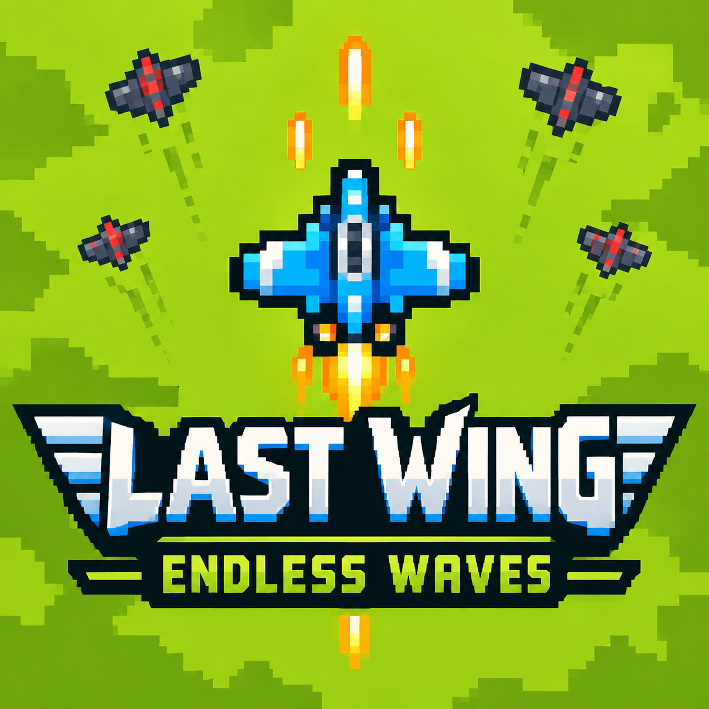
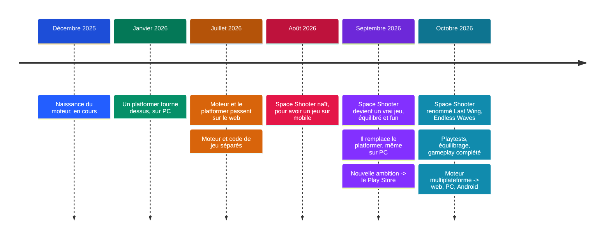
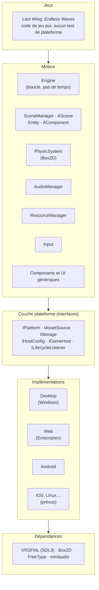
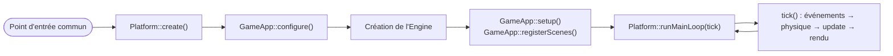
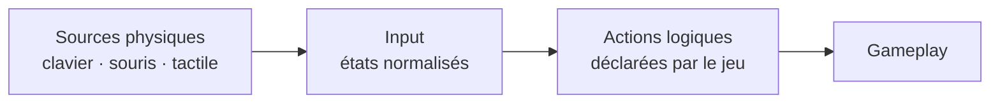

# 🎮 2D Game Engine

**Un moteur de jeu 2D en C++ écrit from scratch, qui fait tourner *Last Wing: Endless Waves* sur Windows, dans le navigateur et bientôt sur Android.**

> 🔒 Ce dépôt est une **vitrine** : il explique comment le moteur est conçu, comment il est né et ce qu'il fait tourner. Son code source n'est volontairement pas publié.

  

  <a href="https://hugoflandrin.github.io/LastWing-EndlessWaves"><b>▶ Jouer à Last Wing dans le navigateur</b></a>

**Sommaire :** [Démo](#-démo) · [En bref](#-en-bref) · [Histoire](#️-comment-le-moteur-est-né) · [Architecture](#-architecture) · [Le jeu](#️-ce-quil-fait-tourner--last-wing-endless-waves) · [Auteur](#-auteur)

---

## 🎬 Démo

https://github.com/user-attachments/assets/259d577b-21b6-42ae-bc3f-2ba4540d8e6b

> Si la vidéo ne s'affiche pas dans votre navigateur : [ouvrir la démo](docs/media/lastwing-demo.mp4).

La version jouable en ligne est hébergée sur **<https://hugoflandrin.github.io/LastWing-EndlessWaves>** : même code que sur Windows, compilé en WebAssembly.

---

## 📜 En bref

| | |
|---|---|
| **Langage** | C++20 |
| **Rendu, fenêtre, entrées, son** | VRSFML (un fork d'SFML construit sur SDL3) |
| **Physique** | Box2D 3.1 |
| **Build** | Un seul projet CMake pour toutes les plateformes |
| **Plateformes** | Windows ✅ · Web (WebAssembly / Emscripten) ✅ · Android 🚧 · iOS et autres : prévus par l'architecture |
| **Jeu qui tourne dessus** | *Last Wing: Endless Waves*, un shoot'em up vertical |

Principe directeur : **le moteur et le jeu ne savent pas sur quelle plateforme ils tournent.** Tout ce qui dépend du système, du navigateur ou du mobile vit derrière quelques petites interfaces. Ajouter une plateforme revient à écrire ces interfaces et un fichier de build, sans toucher ni au moteur ni au jeu.

---

## 🕰️ Comment le moteur est né

*Du cours de moteur à un jeu multiplateforme :*

**Décembre 2025 — la naissance.** Le moteur naît en cours, à **Ynov Lyon**, avec une idée simple : écrire soi-même la base d'un moteur 2D en C++ pour comprendre ce qu'il y a dessous. Boucle de jeu maîtrisée, scènes, entités à composants (le comportement s'assemble au lieu de s'hériter), physique avec Box2D, rendu 2D, entrées et interface de base. Le choix assumé : s'appuyer sur des bibliothèques éprouvées (SFML, Box2D) et se concentrer sur l'architecture plutôt que sur une couche de rendu maison.

**Janvier 2026 — un premier jeu.** Un platformer voit le jour sur le moteur, jouable sur PC. C'est la première démo qui prouve que les briques tiennent ensemble.

**Juillet 2026 — le web, et la séparation.** Le moteur et le platformer sont modifiés pour que ce dernier tourne dans un navigateur. À cette occasion, le moteur et le code de jeu sont **séparés** : le moteur ne connaît aucun jeu, un jeu ne dépend que du moteur. Une règle posée alors et jamais relâchée depuis.

**Août 2026 — Space Shooter.** Un second jeu naît, sous le nom de *Space Shooter*, avec un objectif : avoir **deux démos du moteur**, l'une jouable sur PC, l'autre sur mobile.

**Septembre 2026 — du prototype au vrai jeu.** Par plaisir et par envie, le travail continue sur Space Shooter jusqu'à en faire un vrai jeu, équilibré et fun. Il finit par prendre la place du platformer, même sur PC, et une nouvelle ambition apparaît : le porter un jour sur **Android**, jusqu'au Play Store.

**Octobre 2026 — Last Wing: Endless Waves.** Le jeu est renommé. De nombreux playtests mènent à un équilibrage et à la complétion de son gameplay. Le moteur est ensuite refondu pour devenir **multiplateforme** : web, PC et Android dans un premier temps.

---

## 🧱 Architecture

### Vue en couches

Règles de dépendance, strictes :

- Les **jeux** dépendent du **moteur** uniquement : jamais d'une plateforme, ni d'API système ou navigateur.
- Le **moteur** dépend des **interfaces** de la couche plateforme, jamais d'une implémentation.
- Une implémentation de plateforme ne dépend que des interfaces, de VRSFML/SDL3 et de l'API de sa plateforme.
- Un script de contrôle de portabilité refuse tout test de plateforme en dehors du dossier des plateformes.

### La boucle de jeu

- `tick()` est **la seule fonction de frame**. Elle ignore comment la boucle est pilotée : c'est la plateforme qui l'appelle (boucle classique sur desktop, boucle du navigateur sur le web, boucle SDL sur mobile).
- Chaque jeu fournit une classe `GameApp` et **aucun `main()`**. Les contraintes propres à chaque cible sont gérées une seule fois, dans le point d'entrée commun.
- Le pas de temps est **borné** : un onglet masqué, un débogueur ou un chargement long ne produit jamais un énorme `deltaTime`.
- Un rapport de temps de frame (images par seconde, répartition du coût) s'active par une clé de configuration, sans coût quand il est coupé.

### Scènes, entités, composants

- **`AScene`** possède ses entités. Les ajouts et suppressions sont **différés** (listes en attente validées en fin de mise à jour), ce qui permet de créer ou détruire des entités depuis un composant en pleine itération.
- **`Entity`** est un conteneur de composants ; elle possède ses composants.
- **`AComponent`** expose deux méthodes, `update(deltaTime)` et `draw(...)`. Tout le comportement du jeu s'écrit ainsi : un vaisseau, un ennemi, une explosion, un compteur sont des assemblages de composants.
- **Ordre de rendu** : les entités se dessinent dans l'ordre d'ajout, avec une option « dessinée au-dessus de tout » pour les calques qui doivent recouvrir la scène (par exemple le filtre du ralenti). Les entités d'interface sont dessinées en dernier, avec une vue fixe indépendante de la caméra.
- **Composants génériques** fournis par le moteur : transformation, rendu, corps rigide, colliders, déplacement, points de vie, boutons, texte, barre de vie, compte à rebours, score.

### Physique

- **Box2D 3.1** en pas fixe (1/60 s), avec des sous-pas pour rester stable quand une image dure longtemps.
- Les contacts sont convertis en événements distribués aux composants des deux entités concernées (début et fin de contact).

### Rendu et résolution

- Backend **VRSFML** : OpenGL sur desktop, OpenGL ES / WebGL2 sur le web et le mobile.
- **Résolution virtuelle** : chaque scène déclare la taille de son monde ; le letterbox s'applique à la caméra plutôt qu'à la fenêtre, pour rester fiable sur tous les backends.
- **Écrans haute densité** : la surface de rendu est créée à la taille réelle en pixels, pas à la taille logique. L'image reste nette sur un téléphone.
- **Zones sûres** : l'interface se cale sur les marges à laisser libres (encoches, barres système, boutons de la page hôte), fournies par la plateforme.
- **Perte du contexte graphique** (retour d'arrière-plan sur mobile) : les ressources sont rechargées automatiquement.

### Audio

Un seul point d'accès au son, `AudioManager` :

- volumes séparés effets et musique, coupure indépendante ;
- **hauteur de la musique en deux couches** : une couche de fond (le tempo de la partie) et une couche d'effet (ralenti), qui se cumulent sans s'écraser ;
- gain par son, réglable au-dessus du niveau par défaut pour faire ressortir un effet, avec un plafond de sécurité côté sortie ;
- **préchargement** des effets avant le début de la partie : décoder un son au premier usage bloque l'image et désynchronise ce qui lui est lié ;
- suspension de la lecture en arrière-plan, reprise au retour.

### Ressources

- `ResourceManager` charge textures, polices et sons avec un **cache**.
- Il ne manipule jamais de chemin système : il demande des octets à la source d'assets de la plateforme et construit les objets graphiques et sonores depuis la mémoire.
- Les noms d'assets sont **logiques** et identiques partout (`"ships.png"`).

| Plateforme | Source des assets |
|---|---|
| Desktop | Dossier à côté de l'exécutable |
| Web | Système de fichiers virtuel intégré au build (préchargé) |
| Android | Archive de l'application |

### Entrées

- Le gameplay ne lit **jamais** directement le clavier ou la souris : il lit des **actions** (axe de déplacement, tir, pause…) que chaque jeu déclare et lie aux touches.
- Le tactile est normalisé : position en pixels, état appuyé / relâché, suivi du doigt. Les contournements propres au navigateur vivent dans la plateforme web et alimentent la même source.
- La position pointée est déjà convertie en coordonnées du monde via la caméra de la scène courante.

### La couche plateforme

Six interfaces, chacune volontairement petite :

| Interface | Rôle |
|---|---|
| `IPlatform` | Fenêtre, informations d'affichage (taille réelle, densité, zones sûres), classe d'appareil (desktop ou mobile), pilotage de la boucle principale, accès aux sous-services |
| `IAssetSource` | Lecture des fichiers de ressources par nom logique |
| `IStorage` | Persistance clé / valeur (réglages, scores) : fichier sur desktop, stockage du navigateur sur le web, stockage privé sur Android |
| `IHostConfig` | Configuration fournie par l'environnement (langue, difficulté, mode, appareil, zones sûres) : paramètres d'URL sur le web, arguments sur desktop |
| `IGameHost` | Événements **sortants** (fin de partie, demande de fermeture) et commandes **entrantes** (volumes, pause) entre le jeu et son environnement |
| `ILifecycleListener` | Pause, reprise, manque de mémoire, redimensionnement, demande de fermeture, poussés par la plateforme |

Le jeu demande par exemple « quelle difficulté ? » à la configuration hôte sans savoir si la valeur vient d'une URL, d'un argument de ligne de commande ou d'un intent Android.

### Cycle de vie

| Événement | Réaction du moteur |
|---|---|
| Pause (onglet masqué, application en arrière-plan) | Simulation gelée, musique en pause, sauvegarde des données |
| Reprise | Simulation relancée, audio repris, ressources rechargées si le contexte graphique a été perdu, horloge remise à zéro (pas de pic de temps) |
| Redimensionnement / rotation | Recalcul de la caméra, du letterbox et du cadre d'interface |
| Demande de fermeture | Fin de boucle propre, ou demande à la page hôte sur le web |

La pause demandée par l'hôte (panneau de réglages de la page web) et la pause automatique de l'arrière-plan sont indépendantes : revenir d'un onglet ne défait jamais une pause demandée par le joueur.

### Système de build

- **Un seul projet CMake** pour toutes les plateformes ; la plateforme est déduite de la chaîne d'outils (Emscripten → web, NDK → Android, sinon Windows).
- Une fonction `add_game` déclare un jeu en un appel ; chaque plateforme décide de ce qu'elle produit :

| Plateforme | Résultat |
|---|---|
| Windows (clang-cl) | Exécutable, ressources copiées à côté |
| Web (Emscripten) | Page HTML + WebAssembly, ressources préchargées, shell HTML générique |
| Android | Bibliothèque native empaquetée par Gradle en APK |

- Dépendances **figées** (commit de VRSFML, version de Box2D) : un clone propre redonne le même résultat.
- Une cible CMake par jeu, un preset par plateforme : le jeu et la plateforme se choisissent indépendamment.
- Chaque build web remplace automatiquement la version publiée du jeu.

### Ajouter une plateforme

Exemple : iOS. Ni le moteur ni les jeux ne changent.

1. Un fichier de build pour la plateforme (chaîne d'outils, options, empaquetage).
2. Une implémentation de `IPlatform` et de ses sous-services (assets du bundle, stockage utilisateur, configuration, hôte), qui relaie le cycle de vie du système vers le moteur et fournit les vraies zones sûres.
3. Brancher la fabrique de plateforme sur cette implémentation pour la cible.

Si une plateforme demande un service nouveau (vibrations, achats intégrés…), on **ajoute une interface** avec une implémentation vide par défaut : les jeux qui n'en ont pas besoin ne changent pas.

### Conventions

- **Aucun test de plateforme** hors du dossier des plateformes ; un script de contrôle le vérifie.
- **Propriété explicite** : la scène possède ses entités, l'entité ses composants ; les pointeurs bruts ne servent que de références non possédantes.
- **Chemins** toujours relatifs avec `/` et noms d'assets logiques.
- **Temps** : tout le gameplay reçoit `deltaTime`, aucune lecture d'horloge dans les composants.
- **Pas de dépendance de jeu dans le moteur** : un nom de jeu dans le moteur est un défaut à corriger.

### Où en est chaque plateforme

| Critère | Windows | Web | Android |
|---|---|---|---|
| Démarrage et bonne résolution (densité, zones sûres) | ✅ | ✅ | 🚧 |
| Assets, entrées, audio | ✅ | ✅ | 🚧 |
| Pause / reprise, perte de contexte | ✅ | ✅ | 🚧 |
| Persistance, configuration hôte | ✅ | ✅ | 🚧 |
| Build reproductible depuis un clone propre | ✅ | ✅ | 🚧 |

Sur Android, le jeu se compile et tourne déjà sur l'émulateur ; le reste est en cours.

---

## 🛰️ Ce qu'il fait tourner : *Last Wing: Endless Waves*

Un shoot'em up vertical, jouable au clavier comme au doigt.

### Modes de jeu

| Mode | Description |
|---|---|
| **Course chronométrée** | Une partie courte et dense contre la montre |
| **Infini, solo** | On survit le plus longtemps possible, en visant le meilleur score |
| **Infini, coopératif à deux** | Deux vaisseaux sur le même écran, deux joueurs sur le même clavier |

Trois **difficultés** (facile, moyen, difficile) changent le nombre d'ennemis, leur résistance, la puissance de leurs tirs, les dégâts de contact et la générosité des bonus. Le multiplicateur de score maximal dépend de la difficulté : plus le niveau est élevé, plus le meilleur score possible l'est aussi.

**Objectif : atteindre 1 000 000 points.** Aucune partie ne peut durer indéfiniment : toutes les difficultés montent en puissance sans fin (ennemis plus rapides, plus résistants, tirs plus fréquents).

### Ennemis

Une dizaine de types, introduits progressivement au fil de la partie pour laisser le temps d'apprendre :

- **Basic, Fast, Tank** : la base, du fragile et rapide au lent et résistant ;
- **Shooter, Sniper, Spread** : trois façons de tirer (tir droit, tir visé et lent, double canon en diagonale) ;
- **Diver** : plonge en diagonale vers le joueur ;
- **Zigzag** : se faufile en sinusoïde ;
- **Splitter** : se divise en fragments à sa mort ;
- **Élites** : des ennemis marqués d'une aura dorée, plus résistants et plus rémunérateurs, qui lâchent un bonus puissant.

### Bonus

Des bonus **durables** (en doré) et **temporaires** (en cyan) tombent des ennemis :

- cadence de tir, tir multiple, tir double, dégâts accrus ;
- bouclier, soin, aimant à pièces, **drone** allié ;
- **ralenti** : les ennemis et leurs tirs ralentissent dans une onde bleue, le décor et la musique aussi ;
- **bombe** : une onde de choc balaie l'écran, détruit les ennemis et efface les tirs ;
- **score** : un multiplicateur permanent, affiché devant le score.

### Une partie qui s'anime

La difficulté ne monte pas par paliers brutaux : après une ouverture calme, c'est le **dynamisme** qui augmente. Il y a de plus en plus d'ennemis, de plus en plus de bonus, un décor qui défile plus vite et une musique dont le tempo suit l'intensité. Un cycle **jour / nuit** teinte le décor sur plusieurs minutes. La résistance des ennemis suit celle que le joueur a eu le temps d'acquérir avec ses bonus de dégâts.

### Ce que le moteur apporte au jeu

| Besoin du jeu | Brique du moteur |
|---|---|
| Des centaines d'entités qui naissent et meurent chaque seconde | Scène à ajouts / suppressions différés |
| Collisions balles / ennemis / vaisseaux | Box2D et événements de contact |
| Effets qui doivent recouvrir tout l'écran | Ordre de rendu avec calque « au-dessus de tout » |
| Sons nombreux et synchronisés avec les effets | Préchargement des sons et gain par effet |
| Musique dont le tempo suit la partie, et que le ralenti ralentit aussi | Hauteur de la musique en deux couches |
| Net sur téléphone, interface qui évite les boutons de la page | Rendu haute densité et zones sûres |
| Même jeu sur PC et sur mobile | Entrées normalisées (clavier, tactile), détection de l'appareil |
| Page web qui règle difficulté, volumes, pause et reçoit la fin de partie | Interface hôte du moteur |

---

## 🧑‍💻 Auteur

Développé par **Hugo Flandrin** ([@HugoFlandrin](https://github.com/HugoFlandrin)).

Le code n'est pas public. Pour en discuter, écrivez-moi via mon profil GitHub.

## Licence

Copyright © 2026 Hugo Flandrin. Tous droits réservés.

Ce dépôt est une vitrine : il présente un moteur de jeu 2D et le jeu qui tourne dessus
(documentation, schémas, captures et vidéo). Le code source du moteur et du jeu n'est pas publié
et n'est pas placé sous licence libre. Aucune réutilisation, copie ou redistribution du code ou
des ressources du jeu n'est autorisée sans accord écrit de l'auteur.

La documentation et les médias de ce dépôt peuvent être cités ou partagés avec mention de l'auteur
et lien vers ce dépôt.
